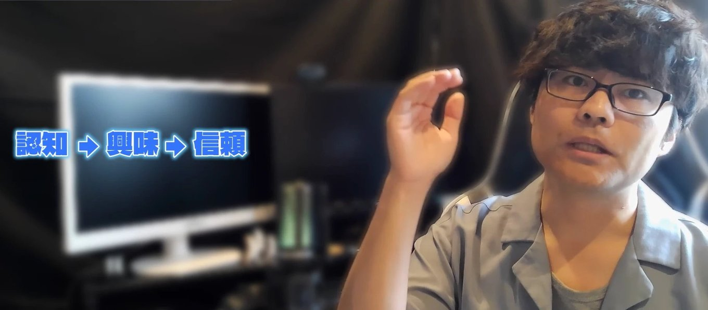

どーも！とーるです！

最近、なんでもかんでも「AI、AI」になっていませんか。

投稿もAI。
画像もAI。
お客さんへのアドバイスも、AI。

便利なのは間違いないです。
僕もかなり使っています。

ただ、AIには**表に出していい場面と、出しちゃいけない場面**があります。

その境目は、あなたのビジネスの**「根幹」**です。

そしてこれ、実はAIだけの話じゃないんですよね。
「楽をしていい場所」と「楽をしちゃいけない場所」の話です。

## 厨房の電子レンジ

ちょっと想像してみてください。

「スープは毎朝6時間炊いています。味で勝負！」
そう掲げているラーメン屋さんに入ったとします。

カウンターから厨房が見えるお店です。

ふと見ると、店主がカウンターの陰で、電子レンジから丼を取り出していた。

…どう思いますか。

たぶん、味がどうこうの前に、**「え、騙された？」**が来ると思います。

ここで大事なのは、電子レンジが悪いわけじゃない、ということです。

同じ電子レンジでも、
「安い、早い、お腹がすいたら気軽にどうぞ」
がウリのお店なら、そこまでがっかりしないはずです。

がっかりするのは、**ウリにしているところで、楽をされたとき**なんですよね。

## 努力ヒューリスティック——人は「手間」を、価値として見ている

行動経済学・心理学に、**努力ヒューリスティック**という考え方があります。

人は、**手間がかかっていそうなものほど、価値が高いと感じる**、というものです。

2004年に発表された研究では、同じ詩や絵を見せて、「短い時間で作った」と伝えるか、「長い時間をかけた」と伝えるかを変えただけで、時間をかけたと聞いたほうが、出来ばえまで高く評価されました。

作品は同じです。
変わったのは、「どれだけ手間がかかったと思うか」だけ。

つまり人は、モノそのものだけじゃなく、**その向こうにある手間ごと**、価値を感じているんです。

だから、ウリの部分の手間が実は省かれていたと分かった瞬間、価値が一気に下がって見える。

電子レンジのラーメンでがっかりするのは、これです。

AIでも同じことが起きていて、**同じ絵でも「AIが作った」と言われると評価が下がる**、という研究もあります。
絵は1ミリも変わっていないのに、です。

## 猫動画と、AIドラマ

SNSを見ていると、AIで作ったショート動画がよく流れてきますよね。

コメント欄をのぞくと、
「はいはいAI」
「AIじゃねーか」
という声もけっこうあります。

たとえば猫動画。

猫好きの人は、ついつい見てしまいます。
僕も見てしまいます。完全に負けています。

でも、猫動画の根幹は**「本物の猫の、かわいい姿」**です。
それがAIで作られたものだと分かると、だまされた感じがする。

一方で、AIで作ったドラマも、最近は増えています。

こちらは、そこまで「騙された！」とはなりにくいんですよね。

ドラマはそもそも、作り話だという前提で見ているからです。
台本や脚本がAIかもしれない、という疑いはあっても、それは表には出てこない、裏の部分。

「この台本、AIなのかな？人が書いてるのかな？」
と思いながらも、人は続きを見てしまいます。

同じAIでも、**根幹に使ったか、裏方に使ったか**で、受け取られ方がまるで違う。

## 「AIかな？」は、自分で答えを出さない

もうひとつ、おもしろいところがあります。

「AIかな？」と思われているうちは、まだ大丈夫なんです。
疑いのまま、見てもらえます。

ところが、それを自分から**「AIで作りました」**と出してしまうと、どうなるか。

疑いが、**答え**に変わります。

答えになった瞬間、さっきの努力ヒューリスティックが働いて、がっかりされる。

ここで言いたいのは、「AIを使っていることを隠せ」という話ではありません。

**根幹にAIを使ったまま、それを表に出すのが、いちばんまずい**、という話です。

## コンサルがAIの答えを、そのまま渡していたら

たとえば、コンサルタントがAIにアドバイスをもらって、それをそのまま顧客に伝えていたとします。

これ、どう思いますか。

コンサルの根幹は、**その人自身の考えと経験**です。
お客さんは、そこにお金を払っています。

その根幹を、AIで省いてしまっている。

さらに最悪なのは、それを表に出してしまうことです。
「AIに聞いたらこう出ました」と。

そうなるとお客さんは、
「じゃあ、自分でAIに聞けばよかったのでは」
と思いますよね。

ラーメン屋さんでいえば、厨房の真ん中に電子レンジを置いて、「味で勝負！」と言っているようなものです。

## 僕の講座でも、手間の置き場所を分けています

手間の話でいうと、僕の講座もそうです。

メインの講座は、僕が顔を出して、カメラに向かって話す形で撮っています。
いわゆるトーキングヘッド型です。

メインの講座なので、価格もそれなりにいただいています。
だから、ここには手間をかけています。

一方で、定期的にやっているオンライン勉強会は、スライド型です。
回数が多いので、スライドはAIに台本や構成を渡して、作ってもらっています。

ただ、それで終わりにはしていません。
スライドにも、少しだけ自分の手を入れています。

ここで大事なのは、**手間は、自分がかけたつもりでもダメ**だということです。
相手に伝わっていないと、手間はないのと同じなんですよね。

努力ヒューリスティックが働くのは、「実際にかかった手間」ではなく、**「相手が感じた手間」**のほうです。

## 1か月の本と、2〜3日の本

電子書籍も、いまはAIを使えば2〜3日で作れてしまいます。

では、

「1か月考えて、やっと出来上がりました！」という本と、
「AIで2〜3日で作りました！」という本。

どちらに価値を感じますか。

中身がまったく同じだったとしても、たぶん前者ですよね。
さっきの詩や絵の研究と、同じことが起きています。

## 「1時間で作りました」と「7日間かけました」

これは、本だけの話じゃありません。

LINEの構築や、動画の制作でも同じです。

「1時間で構築しました」
「7日間かけて構築しました」

出来ばえがまったく同じでも、相手が感じる価値は違います。

ただ、どちらに価値を感じるかは、**相手が何を求めているか**で変わるんですよね。

とにかくすぐ欲しい人にとっては、「1時間でできます」こそが価値です。
しっかりしたものが欲しい人にとっては、「7日間かけました」のほうに価値を感じます。

なので、速さをウリにするなら、それはそれでアリです。
「最短で提出」「すぐできます」を前面に出して、**とにかく急いでいる、今すぐのお客さん**に向ければいい。

ラーメン屋さんでいえば、「安い、早い、気軽にどうぞ」のお店です。
今すぐのお客さんについては、#113でも書きました。

逆に、「しっかりしたもの」を求める人に向けているのに、「1時間で作れました」と出してしまうと、かえって価値が下がって見えることがある。

速さをウリにするのか、中身をウリにするのか。
**誰に向けるかで、見せていい手間の量が変わる**んです。

## 僕の線引き

なので、僕はこう分けています。

**本編と中身は、自分。**
**制作は、AI。**

僕の場合、根幹は**言語化と思考、そして知識**です。

リールやスライド、コンテンツづくりは、AIの手を借りています。
でも、その根幹には絶対に触らせません。

AIをどこまで使っているかは、#127でも書きました。

この分け方をしているから、僕は「AIを使っています」と言えるんですよね。

中身を渡していないので、AIを使っていると知られても、がっかりされる場所がない。

逆に言えば、AIを使っていると言いにくいなら、それは**根幹に使ってしまっているサイン**なのかもしれません。

あなたのビジネスの「ウリ」は、どこですか。

そこさえ自分の手に残っていれば、それ以外は、かなり手放していいと思います。
