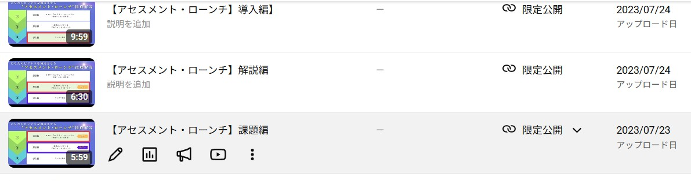
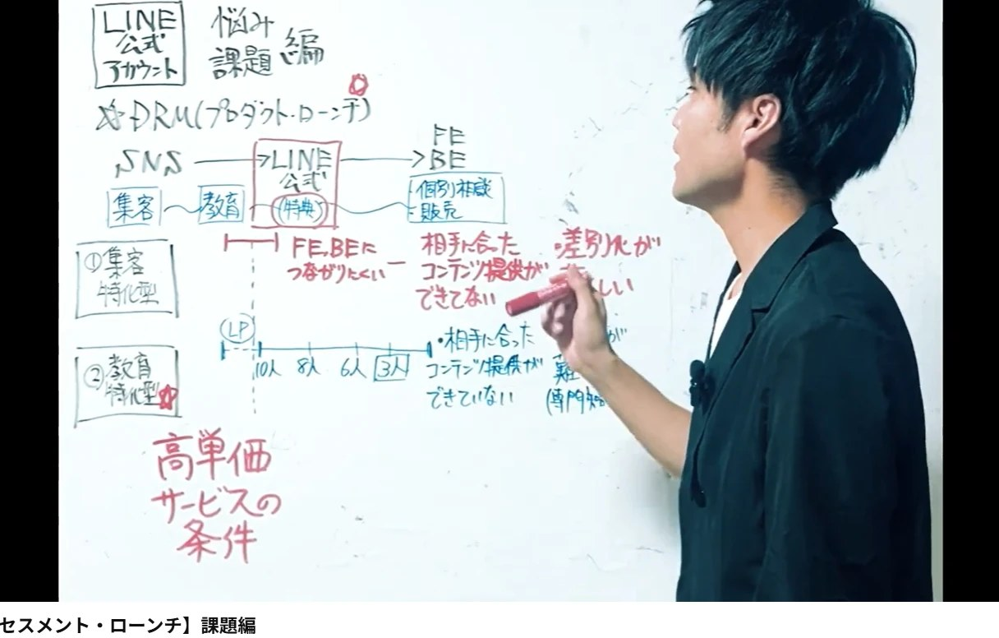

どーも！とーるです！

「どうやって再生数を伸ばすか」
「どうやってフォロワーを増やすか」

SNSをやっていると、つい、ここばかり考えてしまいますよね。

でも本当に考えたいのは、その先です。

**「どうやって、人間関係や購買行動につなげるか」**

今回は、僕の2023年の数字を使って、この話をしてみます。

伝えたいことは2つあるんですが、何が言いたいのかは、全体を通して考えてみてください。

## 僕は、再生数をほとんど見ていません

先に正直に言っておきます。

僕は、リーチ数もフォロワー数も、保存数も再生数も、そんなに意識していません。

なので、そこを増やすための施策や、伸ばすための投稿も、まったく参考にしていません。
これ、まじです。

一番重要視しているのは、ひとつだけ。

**「フォローされてから、どう購買行動につなげるか」**

2023年のころから、ずっとこれです。

## 2023年の、実際の数字

当時の流れは、いまと同じです。

**インスタ → LINE → 動画視聴**

LINEをリリースしてから1か月で、友だち追加は**14名**でした。

そのときのフォロワー数は、100ちょっと。
たしか150くらいだったと思います。

だいたい、**フォロワーの10％**です。

ここは、だいたいこのくらいになります。
フォロワーに対して10％の友だち追加があれば、「興味をもってもらって、誘導する」ところまでの数字としては、ベースラインです。

※フォロワーが多くなるほど、なんとなくフォローしている人も増えるので、この割合は下がっていきます。

そして、そこから**4名**の方が、個別相談に申し込んで、そのまま成約になりました。

友だち追加から見ると、だいたい**30％**です。

## 「少ないのにすごい！」と言われるんですけど

この数字を話すと、よく驚かれます。

「フォロワーが少ないのに、すごい！」と。

でも、数字を大きくしてみると、こうなります。

**フォロワー1,000人 → 友だち追加100名 → 成約30名**

SNSからLINEへの流れとしては、だいたい平均的なラインなんですよね。

母数が少ないから、すごく見える。
でも、**率でいうと「普通」**なんです。

ちょっと残念なお知らせでした。

## 母数を増やすか、率を上げるか

自慢をしたいわけじゃないです。

これが、

- フォロワーを増やすことを目的にしているか
- 再生回数を目的にしているか
- フォロワーを、どう顧客につなげるかを目的にしているか

の違いです。

僕がよく言う、**「母数を増やすか」「率を上げるか」**の、典型的な違いですね。
この考え方そのものは、#99で詳しく書きました。

ただ、どっちが正解、という話ではありません。

僕が、母数を増やすのが苦手なだけです。

リールを頑張って作って再生数を伸ばすよりも、こっちのほうが、僕には相性がいい。
それだけの話です。

## もうひとつ。当時、何を入れていたか

これはまた別の話になります。

当時のLINEは、友だち追加のあとに、3本の動画を見ていく作りにしていました。
いわゆる、エバーグリーンのローンチです。

構成の話をすると、もっと長くなるので、それはまた別の機会にします。
（エバーグリーンそのものについては、#9で書いています。）

ここで見てほしいのは、時期です。

2022年〜2023年のインスタといえば、
**「無料大量特典！」**
が、いちばん盛んだった時代です。

そんな中で、僕が動画で話していたのは、**「診断ファネルのすすめ」**でした。

動画のタイトルにある「アセスメント・ローンチ」というのが、診断ファネルのことです。

そう。
いま、いろんな方が導入しはじめている、あの**「診断ファネル」**です。

## ハーディング——みんなが走る方向は、正しく見える

行動経済学に、**ハーディング（群集行動）**という考え方があります。

みんなが同じ方向へ動いていると、人は「たぶん、そっちが正解なんだろう」と感じて、ついていきたくなる、というものです。

自分で確かめたわけではなくても、**「みんながやっている」ことが、そのまま正しさの証拠に見えてしまう**んですよね。

当時の「無料大量特典」は、まさにこれでした。

みんなが特典を山盛りにしているから、自分も山盛りにする。
山盛りにしないと、損をする気がする。

でも、みんなが同じことをしている場所では、比べられるのは「量」だけになります。
特典の数で勝負すると、もっと多く積める人には勝てません。

逆に言えば、**みんながやっていない場所には、比べる相手がいない**んです。

## 一度、考えてみてください

最後に、今回伝えたかった2つをまとめておきます。

**ひとつめは、「みんながやっていないからこそ、やる勇気」。**

みんなが走っている方向は、正しく見えます。
でも、そこは一番混んでいる場所でもあります。

**ふたつめは、「率を上げることの大事さ」。**

フォロワーが少なくても、つなぎ方を整えれば、ちゃんとお客さんは生まれます。
しかもそれは、特別にすごいことではなく、「普通」の数字です。

いま、あなたが追いかけているのは、母数ですか。
それとも、率ですか。

一度、考えてみてください。
