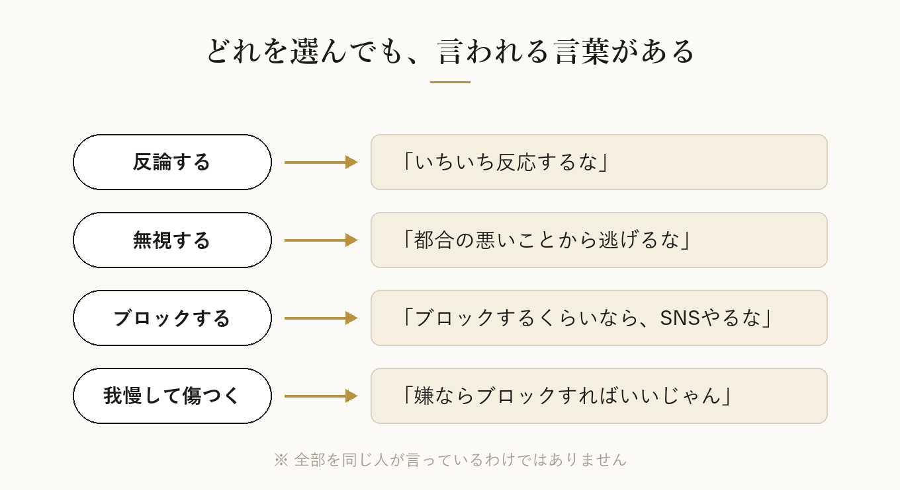
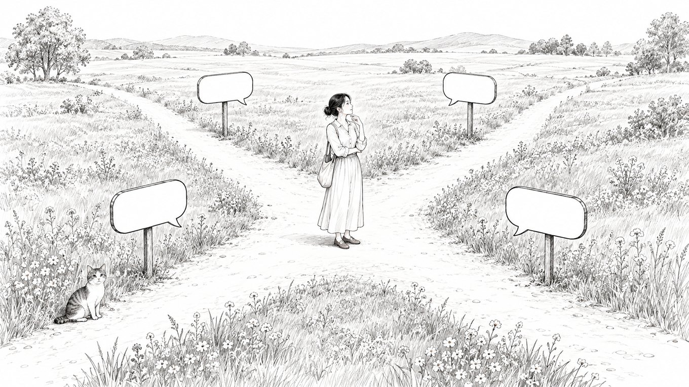
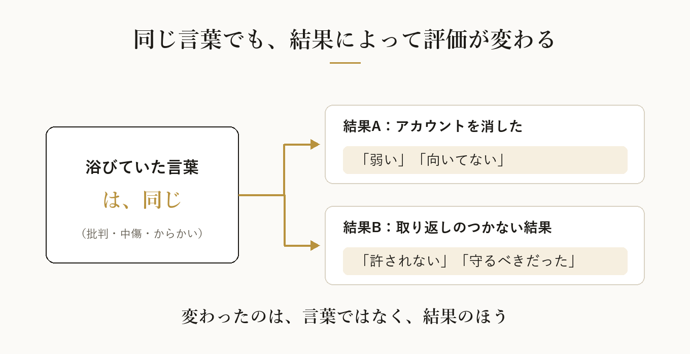
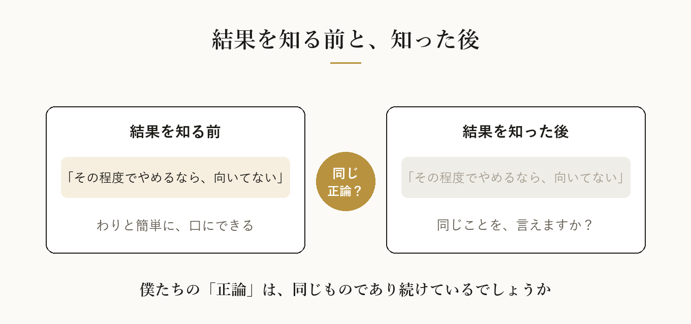

どーも！とーるです！

最近、ずっと引っかかっていることがあります。

SNSって、なかなか不思議な場所だなと思います。

たとえば、誰かが批判されたとき。

反論すれば、
「いちいち反応するな」

無視すれば、
「都合の悪いことから逃げるな」

ブロックすれば、
「ブロックするくらいなら、SNSやるな」

でも、批判を受け続けて傷ついていると、
「嫌ならブロックすればいいじゃん」

……あれ？

さっき、ブロックするなって言われませんでした？

もちろん、全部を同じ人が言っているわけではありません。
ただ、どれもSNSで、よく見かける言葉です。

今回は、誰が良い・悪いを決めたいわけではありません。
**「同じ行動なのに、結果によって評価が変わる」**ことについて、一緒に考えてみたいんです。

## どの道を選んでも、何か言われる

続ければ、
「そんなメンタルなら、発信するな」

休めば、
「その程度で休むなら、向いてない」

やめれば、
「メンタル弱すぎ」

ひとつひとつは、それぞれの立場からすれば「正論」なのかもしれません。

でも、全部を同時に求められたら、発信している人は、どうすればいいんでしょう。

心理学には、どちらを選んでも否定されてしまう状況を指す**「ダブルバインド（二重拘束）」**という言葉があります。

SNSの言葉が、すべて厳密にこれに当たるわけではありません。
ただ、受け取る側からすると、かなり近い状態になっていることはあると思います。

## これ、一部の人だけの話ではありません

総務省の「違法・有害情報相談センター」に寄せられた相談は、2025年度で6,715件。
2010年度の1,337件から、およそ5倍に増えています。

法務省が2025年に救済の手続きを始めた人権侵害の事件のうち、インターネット上のものは1,569件。
こちらも、高い水準が続いていると発表されています。

2022年7月には、ネットでの誹謗中傷が社会問題になったことを受けて、侮辱罪の罰が重くなりました。
それまでは、罪の中でもいちばん軽い部類だったものが、懲役（いまは拘禁刑）や罰金も科せるようになっています。

数字で見ると、「たまたま目にした、ひどい人の話」ではないことが分かります。

※引用元
・総務省「令和7年度 インターネット上の違法・有害情報対応 相談業務等の請負 報告書（概要版）」
https://www.soumu.go.jp/main_content/001078095.pdf
・法務省「令和7年における『人権侵犯事件』の状況について」
https://www.moj.go.jp/JINKEN/jinken05_00117.html
・法務省「侮辱罪の法定刑の引上げ Q&A」
https://www.moj.go.jp/keiji1/keiji12_00194.html

## 結果が変わると、言葉が変わる

もうひとつ、気になっていることがあります。

批判を受けた人が、疲れてアカウントを消したとします。

すると、
「その程度でやめるなら、向いてない」
「批判される覚悟がないなら、発信しないほうがいい」

という声が出てくることがあります。

では、その人がSNSだけでなく、仕事までやめてしまったら。
お店を閉めてしまったら。

そして、取り返しのつかない結果になってしまったら。

たぶん、聞こえてくる言葉は変わります。

「誹謗中傷は、許されない」
「言葉で人を追い詰めてはいけない」
「周りが守ってあげるべきだった」

ここで、少しだけ考えてみたいんです。

その人が浴びていた言葉は、同じだったはずです。

**変わったのは、言葉ではなく、結果のほうです。**

## 結果バイアス——人は「過程」より「結果」で判断してしまう

行動経済学・心理学に、**結果バイアス**という考え方があります。

判断がよかったかどうかを、その中身ではなく、**あとから出た結果で評価してしまう**心理です。

1988年の研究では、同じ手術の判断を説明したうえで、「患者さんが回復した」と伝えるか、「亡くなった」と伝えるかだけを変えました。

すると、判断の中身はまったく同じなのに、悪い結果を聞いた人ほど、その判断を「よくなかった」と評価したんです。

身近な例でいうと、こういうことです。

荒い運転をしても、事故が起きなければ「運転がうまい」と言われる。
事故が起きれば「危ない運転だった」と言われる。

でも、事故が起きなかったからといって、その運転が安全だったわけではありませんよね。

SNSの言葉も、少し似ているのかもしれません。

やめたら「弱い」。
取り返しのつかない結果になったら「許されない」。

**言葉の重さを、言葉そのものではなく、結果で測っている。**

## 人は、他人の苦しみを何で測っているのか

ここで、もうひとつ考えてみたいことがあります。

**人は他人の苦しみを、何を基準に判断しているのでしょうか。**

その人の心の中は、外からは見えません。
見えるのは、やめた、休んだ、閉めた、という**目に見える結果**だけです。

だから第三者は、結果が出るまで、相手の苦しみを測れない。
そして測るときには、たいてい**「自分だったら」**を物差しにしてしまいます。

「自分なら、これくらい平気」
「自分なら、気にしない」

でも、同じ言葉でも、受け取る重さは人によって違います。
その日の体調や、それまでに積み重なっていたものによっても変わります。

**他人が受けた心のダメージを、第三者が自分の基準で評価することはできません。**
評価していいものでも、ないと思っています。

## 批判していい、という話と、どれだけ傷つけたか、という話は別

「そんなメンタルなら、SNSやるな」という言葉があります。

これは、**「批判に耐えられるかどうか」**の話をしています。

でも、それと、

**「他人を傷つける言葉を、口にしていいかどうか」**

は、まったく別の問題です。

相手が耐えられる人なら、何を言ってもいい。
そういう話には、ならないですよね。

ここで誤解してほしくないのは、批判すること自体が悪い、と言いたいわけではないことです。

発信する自由があるのと同じように、その発信に意見する自由もあります。
内容に問題があれば、指摘されることもあるでしょう。

ただ、

**その批判が正しいかどうか**という話と、
**その批判で、相手がどれだけ傷ついたか**という話は、

別々に考えたほうがいいと思っています。

そしてもうひとつ。

批判する自由があることと、相手にその批判を受け取り続けさせる権利があることも、別の話です。

「ブロックして逃げるな」という言葉は、ここが混ざってしまっているのかもしれません。

誰の言葉を見ないか、誰と関わらないかを決める自由は、発信する人の側にもあります。

## 結果を知る前と、知った後

僕たちは、自分が正しいと思うことを、わりと簡単に口にできます。

でも、その正しさが、別の場面でも同じように成り立つとは限りません。

たとえば、相手がSNSをやめただけなら言える言葉。
それが、取り返しのつかない結果のあとでは、とても言えなくなる。

もし、そんな言葉があるとしたら。

それは本当に、結果に関係なく正しい言葉だったのでしょうか。

誰が良いとか、悪いとか。
そういう結論を出したいわけではありません。

ただ、ひとつだけ。

**結果を知る前と、知った後。**
**僕たちの「正論」は、同じものであり続けているでしょうか。**

いい、悪い、ではなく。

何かを発信する前に、一度だけ考えてみてください。

最終的に判断するのは、あなたです。

---

※もし今、つらい気持ちを抱えている方がいたら、ひとりで抱えずに話してみてください。
「いのちの電話」や、厚生労働省の「まもろうよ こころ」で、電話やSNSの相談窓口が紹介されています。
