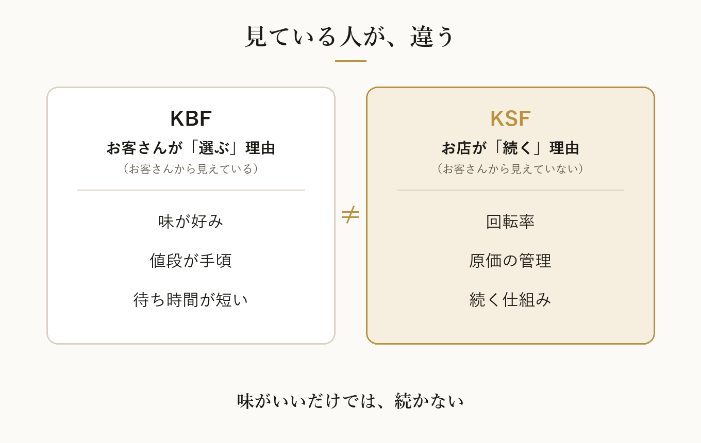

どーも！とーるです！

「あそこのラーメン、めちゃくちゃ美味しかったのに、閉店してた」

こういうこと、ありませんか。

味はいい。
評判もいい。
なのに、続かない。

逆に、「まあ普通においしいよね」くらいの店が、何十年も続いていたりします。

美味しい店ほど潰れる説。
ちょっと信じかけてしまいます。

この差は、どこから来るのか。
今回は、2つの言葉で整理してみます。

## KSFとKBF——「続く理由」と「選ばれる理由」は別もの

以前のコラム（#90）で、KSFという言葉を紹介しました。
成果にいちばん影響する要因のことです。

今回は、そこにもうひとつ、KBFという言葉を並べます。

- **KSF（Key Success Factor）**　→　事業が**勝つ**ための要因
- **KBF（Key Buying Factor）**　→　お客さんが**選ぶ**ときの理由

どちらも「K」で始まって、どちらも横文字。
正直、覚える気が失せますよね。

要するに、
**KSFは「お店側の事情」、KBFは「お客さん側の事情」**です。

見ている人が、まったく違うんです。

## お客さんが見ているもの（KBF）

ラーメン屋で考えてみます。

お客さんが店を選ぶとき、頭の中で比べているのは、たぶんこのあたりです。

- 味が好みかどうか
- 値段が手頃かどうか
- 待ち時間が短いかどうか
- お店がきれいかどうか
- SNSで見かけたかどうか

これがKBFです。
お客さんが**意識して**比べているものです。

## お店が続くために必要なもの（KSF）

一方で、お店が続くために必要なのは、こういうものです。

- 回転率（席数×回転数で、売上の上限が決まる）
- 原価の管理
- 味の安定（誰が作っても同じ味になるか）
- 立地
- スタッフが育つ仕組み

これがKSFです。

見てのとおり、**ほとんどがお客さんからは見えません。**

「この店、原価管理しっかりしてるな〜」と思いながらラーメンをすする人は、たぶんいません。
いたら、ちょっと怖いです。

## いちばん大事なのは、2つが「一致しない」こと

ここが今回の本題です。

KSFとKBFは、**一致しないことのほうが多い**んです。

お客さんは「味」で選びます（KBF）。
でも、お店が続くかどうかを決めているのは、「回転率」や「原価」（KSF）だったりする。

だから、
**味がいいだけでは、続かない。**

どれだけ美味しくても、1杯に40分かかる店は、席が回りません。
原価をかけすぎれば、売れるほど苦しくなります。

味が普通でも続く店は、たいてい、こっち（KSF）がしっかりしています。

冒頭の「美味しかったのに閉店してた」は、
KBFは満たしていたのに、KSFが整っていなかった、ということなんですよね。

## SNSビジネスに置き換えると

これ、ラーメン屋だけの話ではありません。

SNSで発信しながら商品を売っている人に置き換えると、こうなります。

**お客さんが選ぶ理由（KBF）**

- 話がわかりやすい
- 人柄が好き
- 実績がある
- 値段に納得できる
- 評判がいい

**事業が続く理由（KSF）**

- 受講生が続けてくれるか（継続率）
- 紹介が生まれる仕組みがあるか
- 教えた内容を、受講生が再現できるか
- 収益の構造が、無理なく回っているか

よく見かけるのが、
「発信は人気なのに、毎月ずっと集客に追われている」という状態です。

これは、KBFは機能しているのに、KSFが整っていないケースです。
選ばれてはいる。
でも、続く仕組みがない。

まさに、美味しいのに潰れるラーメン屋と同じ形です。

## 片方だけでは、どちらも足りない

逆のパターンもあります。

継続率や仕組みばかり磨いて、
お客さんが何で選んでいるのか（KBF）を見ていない。

すると今度は、**そもそも選ばれません。**

- KBFだけ整える　→　選ばれるけど、続かない
- KSFだけ整える　→　続く形はあるけど、選ばれない

両方そろって、はじめて「売れ続ける」になります。

## 自分のビジネスで、2つを分けて書き出してみる

やることはシンプルです。
紙を1枚用意して、真ん中に線を引いてください。

左に「お客さんは、なぜ自分を選んでくれているのか」（KBF）。
右に「自分の事業が続いているのは、何がうまくいっているからか」（KSF）。

書いてみると、たいていどちらかが薄いです。

「良いものを作っているのに売れない」なら、左（KBF）を見直す。
「売れているのに苦しい・続かない」なら、右（KSF）を見直す。

どっちが薄いかが分かるだけで、次にやることがかなり絞れます。

## 僕が気をつけていること

正直に言うと、発信をしていると、つい左側（KBF）ばかり気になります。

反応がいい投稿。
伸びた投稿。
褒めてもらえた言葉。

目に見えるので、どうしてもそっちを追いかけたくなるんですよね。

でも、事業として続けられるかどうかは、だいたい右側（KSF）で決まっています。

なので僕は、投稿が伸びたことを喜ぶのと同じくらい、
「続けてくれている人がいるか」を見るようにしています。

美味しいラーメンを出し続けるためにも、
まずは、店が潰れないこと。

あなたのビジネスの「味」と「回転率」は、それぞれ何でしょうか。
