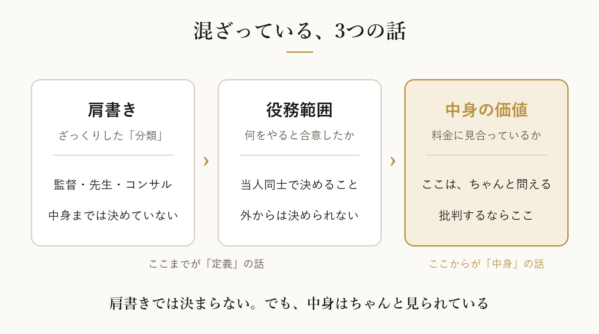

どーも！とーるです！

最近、スレッズで「コンサル」の話題が盛り上がっていますね。

「コンサルなら、ここまでやるべき」
「それをやらないなら、コンサルじゃない」

……盛り上がっている、というか、だいぶ燃えています。

見ていて、ひとつ聞いてみたくなりました。

そもそも「監督」って、何をする人ですか？
「先生」って、何をする人ですか？
「店長」って、何をする人ですか？

## 同じ「監督」でも、やっていることは違う

スポーツの監督を思い浮かべてみてください。

- ベンチから戦略だけを指示する監督
- グラウンドに出て、技術を直接教える監督
- 練習には口を出さず、チーム全体のマネジメントに徹する監督

どれも「監督」です。

先生も同じです。

- 授業で知識を教える先生
- 問題を解かせて、添削する先生
- 学習計画の管理まで見てくれる先生

これも全部「先生」。

でも、誰かが横から
「先生なら、学習計画まで見るべきだ！」
と言い出したら、ちょっと変ですよね。

その先生と生徒のあいだで「うちは授業だけです」と決まっているなら、それで成り立っているので。

## 肩書きは、ざっくりした「分類」でしかない

つまり、肩書きというのは、大まかな「分類」なんです。

「この人はだいたいこの辺の仕事をしています」という、ラベルのようなもの。
その人が実際に何をするかまでは、肩書きでは決まっていません。

決めているのは、
**提供する人と頼む人のあいだで合意した「役務」**です。
（役務とは、提供するサービスの中身のことです。どこまでやるか、という範囲も含みます）

コンサルタントも同じです。

戦略を提案するだけの人もいれば、
実行まで一緒に走る人も、
制作を代わりにやる人も、
進み具合を管理する人もいます。

どこまでやるかは、**役務範囲**しだい。

なので、大事なのはこの2つです。

**どんな役務を提供すると合意したのか。**
**その役務を、ちゃんと果たしているのか。**

もちろん、説明と中身が違う、合意したことをやらない、誤解させるような売り方をする。
これは問題です。
ここは、はっきり分けて考えたほうがいいところです。

でも、当人同士がきちんと合意している役務に対して、
外から「それはコンサルじゃない」と言うのは、
ちょっと話が飛んでいる気がするんですよね。

## プロトタイプ理論——人は「典型例」で判断している

じゃあ、なんでこういう言い合いが起きるのか。
ここ、心理学的にちょっと面白いところです。

人は「コンサルタント」と聞くと、
頭の中に、自分が知っている「いかにもコンサル」な人を思い浮かべます。

これを説明するのが、**プロトタイプ理論**です。
人は言葉の意味を、定義よりも「いちばんそれっぽい例（典型例）」で捉えている、という考え方です。

たとえば「鳥」と聞いて、何を思い浮かべますか。

たぶん、スズメやハトですよね。
ペンギンを最初に思い浮かべる人は、あまりいないと思います。

でも、ペンギンも鳥です。
飛べないからといって、鳥じゃなくなるわけではありません。
（本人たちも、たぶん気にしていません。）

「コンサル」でも、同じことが起きています。

ある人の頭の中の典型例は、実行までがっつり伴走してくれる人。
別の人の典型例は、戦略だけ示して、あとは任せる人。

**それぞれが自分の「スズメ」を基準にして、相手の「ペンギン」を鳥じゃないと言っている。**

言い合いがかみ合わないのは、たぶんここです。

ただし、コンサルは生き物の分類とは違います。
業界の慣習や文脈で、意味が変わる言葉です。
なので、「何でもコンサルと名乗っていい」という話ではありません。

問題は、**自分が思い浮かべる典型例を、唯一の正解だと思ってしまうこと**です。

## 「コンサルかどうか」と「価値があるかどうか」は、別の話

もう一段だけ、整理させてください。

実はこの議論、2つの話が混ざっています。

- 「それはコンサルと呼べるのか」という、**定義の話**
- 「そのサービスは、料金に見合う価値があるのか」という、**中身の話**

たとえば、アドバイスだけをするコンサルがいたとします。

それだけで「コンサル失格」とは言えません。
アドバイスだけ、という役務で合意しているなら、それで成り立っています。

でも、**そのアドバイスが、払ったお金に見合うかどうか**は、ちゃんと問えます。

以前のコラム（#17）で、「コンサルを名乗っていても、実際は○○屋さんでは？」という話を書きました。
あれも、肩書きの定義を決めたかったわけではありません。
**相手の問題を見抜けているか、という中身の話**でした。

肩書きでは決まらない。
でも、中身はちゃんと見られている。

批判するなら、肩書きではなく、中身のほうだと思うんです。

## 自分の「普通」は、世の中の「標準」とは限らない

「コンサルなら○○すべき」という言葉の裏には、たいてい、その人が見てきた「普通のコンサル」がいます。

それ自体は、悪いことではありません。
誰だって、自分の経験から物事を見ています。

ただ、自分の知っている「普通」は、必ずしも世の中の「標準」ではありません。

自分の知っている定義を、他人の役務範囲にまで当てはめようとしていないか。

これ、コンサルに限らず、
「先生なのに」「親なのに」「社会人なのに」
みたいな言葉にも、同じことが言えるかもしれません。

あなたの頭の中の「スズメ」は、どんな鳥ですか。
