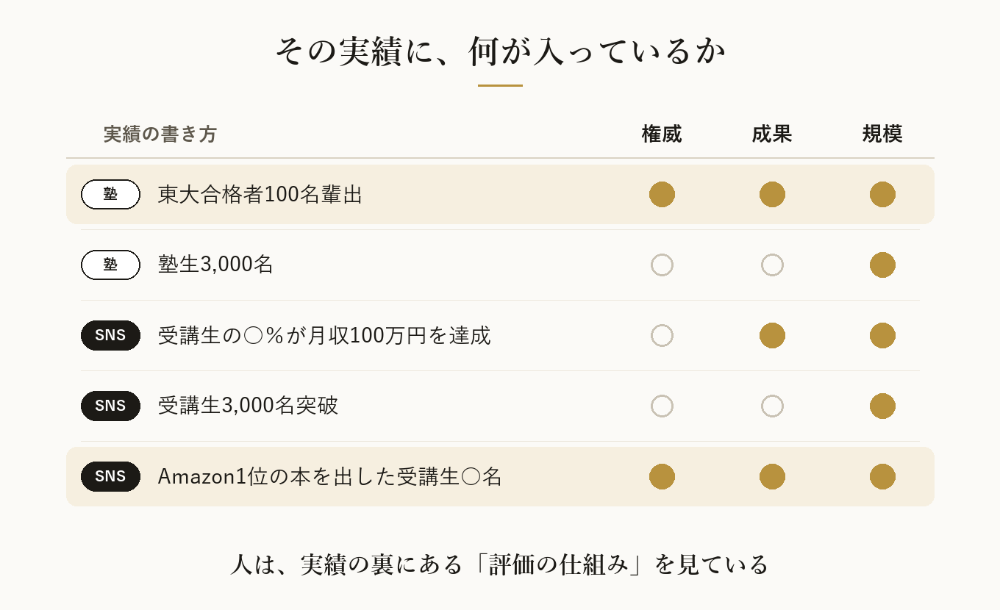

どーも！とーるです！

SNSのプロフィールを見ていると、よく見かける言葉があります。

「売上○○万円」
「受講生○○名」
「サポート実績○○件」

僕のプロフィールには、これを書いていません。

代わりに書いているのは、こんなものです。

- 行動経済学検定1級（第1回合格）
- Amazon 6部門1位
- Udemy 特別賞
- 行動経済アナリスト（日本営業科学協会 認定）

売上も人数もありません。
わざとです。

なんで書かないのか。
自分でも一度ちゃんと整理してみたら、思っていたより奥が深かったので、書いてみます。

## 「評価」と「実績」は、別ものです

この2つ、どちらも「実績」と呼ばれがちですが、中身は違います。

**Amazon1位、Udemyの賞、検定合格**
これは、**誰かに評価された証拠**です。

**売上○○万円、受講生○○名**
これは、**規模や人気の大きさ**です。

前者を見た人は、
「この人、自分でスゴイって言ってるんじゃなくて、外から評価されたんだな」
と受け取ります。

後者は、見る人によっては、
「自慢かな」
「マウントかな」
「自分には関係ないな」
と受け取られることがあります。

## 売上は「本人の数字」、ランキングは「他人が決めた数字」

もうひとつ、大きな違いがあります。

売上は、**本人にしか分からない数字**です。
極端な話、本人が言えばそれで成立してしまいます。

一方で、Amazonのランキングを決めるのはAmazonです。
Udemyの賞を決めるのはUdemyです。
検定の合否を決めるのは、試験を作った側です。

**自分では、決められない。**

だから、信用されやすいんです。

## 東大合格者100名は、なぜ強いのか

これ、塾の広告にたとえると分かりやすいです。

**「塾生3,000名」**
**「東大合格者100名輩出」**

どちらが「すごそう」に見えますか。

たぶん、後者ですよね。
人数は前者のほうが多いのに。

「東大合格者100名」を分解すると、こうなっています。

- **東大**　→　誰もが知っている評価のものさし（権威）
- **合格**　→　はっきりした成果
- **100名**　→　たまたまではない、という規模

**権威 × 成果 × 規模**

この3つが、ひとつの言葉に全部入っているんです。

一方で「塾生3,000名」には、規模しかありません。
たくさん集めた、ということは分かる。
でも、「それで、どうなったの？」が残ります。

## でも、「すごい」と感じるかどうかは、お客さんが決める

ただ、ここでひとつ付け足させてください。

「東大合格者100名」のほうがすごそう、と書きましたが、
これ、**全員にとって**そうなわけではないんです。

たとえば、こんな2組の親子がいたとします。

**Aさん**：「うちの子、東大を目指してるんです」
**Bさん**：「まずは、勉強する習慣をつけてほしくて……」

Aさんにとって、「東大合格者100名」はど真ん中です。

でもBさんにとっては、正直ちょっと遠い世界の話。
むしろ「うちの子、ついていけるかな……」と不安になるかもしれません。

Bさんが安心するのは、たぶん「塾生3,000名」のほうです。
これだけの人が通っているなら、変なところではないだろう、と。

つまり、
**どちらの実績が「すごい」と感じるかは、お客さんが何を求めているかで変わる**んです。

選ぶ基準が違えば、刺さる実績も違う。

「すごい実績」に、正解はありません。
あるのは、**「誰にとって、すごいのか」**だけです。

## 塾の実績と、SNSでよく見る実績

では、SNSでよく見かける実績はどうでしょう。

同じように分解して、塾の実績と並べてみます。

**塾の実績**
- 「東大合格者100名輩出」　→　**権威 × 成果 × 規模**
- 「塾生3,000名」　→　**規模**だけ

**SNSでよく見る実績**
- 「受講生の○％が月収100万円を達成」　→　**成果 × 規模**
- 「受講生3,000名突破」　→　**規模**だけ

見比べると、SNSの実績には、塾の「東大」にあたるものがほとんどありません。

成果も、規模もある。
でも、**それを誰が評価したのか**が見えないんです。

## 「月収100万円達成者、続出！」が胡散臭く見える理由

情報商材の界隈でよく見る、

「月収100万円達成者、続出！」

という言葉。

なんとなく胡散臭く見えるのは、たぶんこれが理由です。

**そこに、権威がないから。**

東大の合格は、大学が決めます。
でも「月収100万円」は、本人の申告だけでも成り立ってしまう。

成果の大きさは伝わっても、それを確かめた第三者がいない。
だから見る側は、
「本当に？」
と感じてしまうんですよね。

数字が大きいほど、かえって疑われる。
ちょっと皮肉な話です。

逆に言えば、同じSNSの実績でも、権威が入ると見え方が変わります。

「Amazonランキング1位の本を出した受講生、○名」

これなら、

- **Amazon1位**　→　権威（Amazonが決めている）
- **出版**　→　成果
- **○名**　→　規模

になって、塾の「東大合格者100名」と同じ形になります。

## 本当に知りたいのは、「自分もそうなれそうか」

もうひとつ、大事なことがあります。

お客さんが本当に知りたいのは、
「この塾がすごいかどうか」ではありません。

**「この塾に入ったら、うちの子はどうなれそうか」**です。

さっきの塾で、
もし同じ年に「塾生3,000名」のうち「東大合格者100名」だったとしたら。

100 ÷ 3,000 で、だいたい**3%**。

100名という数字は大きく見えても、
東大に届いたのは、30人に1人くらいということになります。

もちろん、全員が東大を目指しているわけではないので、単純には比べられません。
でも、「100名」だけを見ていたときと、ちょっと印象が変わりませんか。

数字の大きさに目を奪われると、
**分母**を見るのを忘れてしまうんです。

（行動経済学では、こうした全体の割合を見落としてしまうことを「基準率の無視」と呼びます。）

SNSの実績も同じです。

「月収100万円達成者、続出！」

その「続出」は、何人中の何人なのか。
その人たちは、**自分と同じスタート地点**から始めたのか。

お客さんにとって大事なのは、
誰かのすごい結果ではありません。

**自分がその結果にたどり着ける可能性**のほうです。

## 権威性と社会的証明——人は「誰が評価したか」を見ている

行動経済学・心理学には、**権威性**や**社会的証明**という考え方があります。

人は、専門家や権威のある存在が認めたものを信じやすい。
そして、多くの人が選んでいるものを「よいもの」だと判断しやすい。

ここで大事なのは、**人が信じているのは、数字そのものではない**ということです。

**人は、実績を信じているのではありません。**
**実績の裏にある「評価の仕組み」を信じているんです。**

ランキングなら、売れた数を市場が数えた仕組み。
検定なら、試験という仕組み。
東大なら、入試という仕組み。

その仕組みが見えるから、数字に意味が生まれます。

## 数字は「主役」ではなく「証拠」として置く

じゃあ、数字は一切出さないほうがいいのか。

そうでもありません。

**評価を主役にして、数字は「その評価の証拠」として添える。**

たとえば、こんな並べ方です。

「Amazonカテゴリ1位　／　レビュー○件」
「Udemy○○賞　／　受講生○名」

先に「1位」が目に入って、
あとから「そんなに読まれてるんだ」と数字がついてくる。

順番が逆だと、
「○冊売れました」
「……だから何？」
になりやすいんです。

**数字でドヤるのではなく、評価の裏付けとして数字を置く。**
このくらいの距離感がちょうどいいと思っています。

## 僕だって、売れる月もあれば、売れない月もある

正直に言うと、僕も売上が7桁にいく月もあれば、いかない月もあります。

売上って、そういうものなんですよね。
月によって上下します。

そんな波のある数字を、プロフィールの看板にするのは、ちょっと違うなと思っています。

それに、プロフィールを見てくれた人にとって、僕の売上は、正直あまり関係がありません。
さっきの塾の話と同じで、その人が知りたいのは、「この人から学んで、自分はどうなれそうか」のほうです。

だから、**売上はウリにしない。**

ただ、まったく使わないわけでもありません。
手法を説明するときに、「この方法で、実際にこうなりました」と示す材料としては使います。

**看板には使わない。説明の証拠としては使う。**

ウリにしていい場所と、そうでない場所を分ける、という考え方は、#129で書いた話とも同じです。

## プロフィールに書いたものに、人は集まる

もうひとつ、書かない大きな理由があります。

**プロフィールに書いたものに、人は集まってくる**からです。

売上を看板にすると、
「同じくらい稼ぎたい人」が集まってきます。

評価を看板にすると、
「中身を信頼してくれる人」が集まってきます。

どちらが良い悪いではありません。
ただ、僕が一緒に仕事をしたいのは、後者の人たちです。

つまりプロフィールは、自己紹介であると同時に、**来てほしい人を選ぶ場所**でもあるんですよね。

見込み客と、実際のお客さんが聞きたいことは違う、という話は#104でも書きました。

## 僕は、今すぐのお客さんを集めていない

そもそも僕は、SNSや発信で、今すぐのお客さんを集めようとはしていません。
（今すぐ客の話は、#113で詳しく書きました。）

僕がやっているのは、こういう順番です。

**① 発信の中身で、誠実さや想いに共感してもらう**
**② 何度も目にしてもらう**
**③ その人に「必要」が生まれたときに、思い出してもらえる場所にいる**

①でつくりたいのは、肩書きのような権威だけではありません。
「この人の言うことなら、信じられる」という、**心理的な権威**です。

そこから、接触の回数を重ねていく。
行動経済学・心理学でいう**単純接触効果**で、人は何度も目にするものほど、好感や安心を持ちやすくなります。

そして、その人の中で「そろそろ何とかしたい」が生まれたとき。
真っ先に思い出してもらえる位置にいること。

僕が取りに行っているのは、売上ではなく、この**「思い出してもらえる場所」**なんです。

だから、プロフィールに売上を置かない。
売上の数字は、今すぐ稼ぎたい人には刺さっても、①の「この人なら信じられる」には、あまり効かないからです。

## 評価は「取りに行くもの」、売上は「ついてくるもの」

正直に言うと、KindleやUdemyの実績は、狙って取りに行きました。

「この人は、外からちゃんと評価されている」
そう示せるものを、自分で作りにいったんです。

一方で、売上や生徒数は、狙って積み上げるものというより、やるべきことを続けた結果として、あとから自然とついてくるもの。

なので、僕の中ではこう分けています。

**自分で取りに行った「評価」は、プロフィールに載せる。**
**あとからついてきた「売上や人数」は、看板にしない。**

ちょっと計算高く聞こえるかもしれません。

でも、売上は自分で言うしかない数字です。
評価は、他人が決める。

だから、取りに行くことはできても、**盛ることはできない**んですよね。

売上や人数は、プロフィールに書かなくても、仕事を見てもらえれば伝わる。
そう思っているから、看板には置いていません。

## 僕がいちばん信じている実績

最後に、プロフィールには書いていないけれど、僕がいちばん信じている実績の話をさせてください。

フォロワーは、決して多くありません。
それでも、事業は**5年**続いています。

続けられたのは、僕が自分で決めたことではありません。
お客さんが、選び続けてくれた結果です。

自分では盛れない数字。
誰かに評価され続けた証拠。

そういう意味では、これがいちばん「第三者評価」に近い実績なのかもしれません。

あなたのプロフィールに並んでいる実績は、誰が決めたものですか。
そして、見てくれた人が「自分もそうなれそう」と思えるものになっていますか。

一度、見直してみてください。
